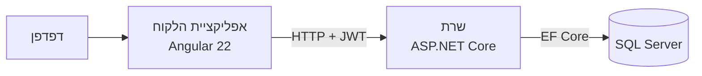
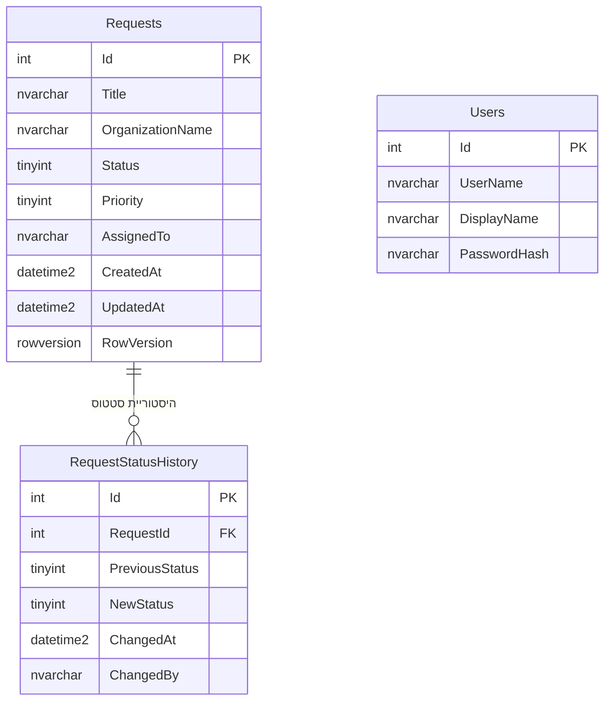
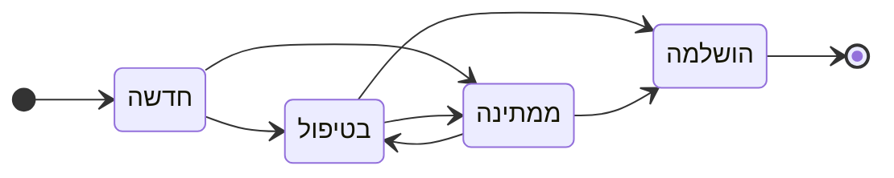
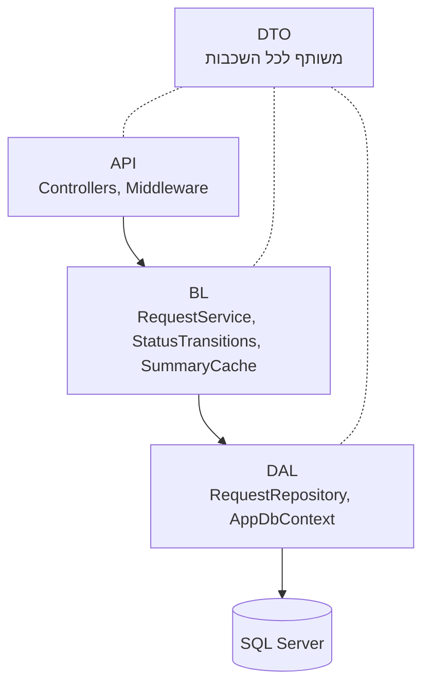
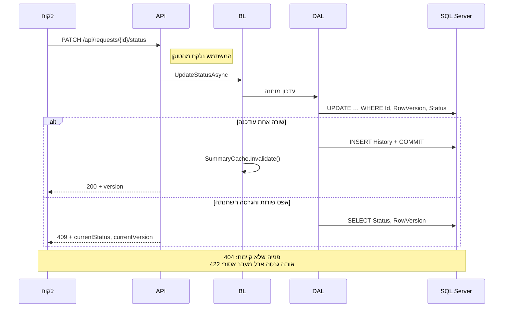
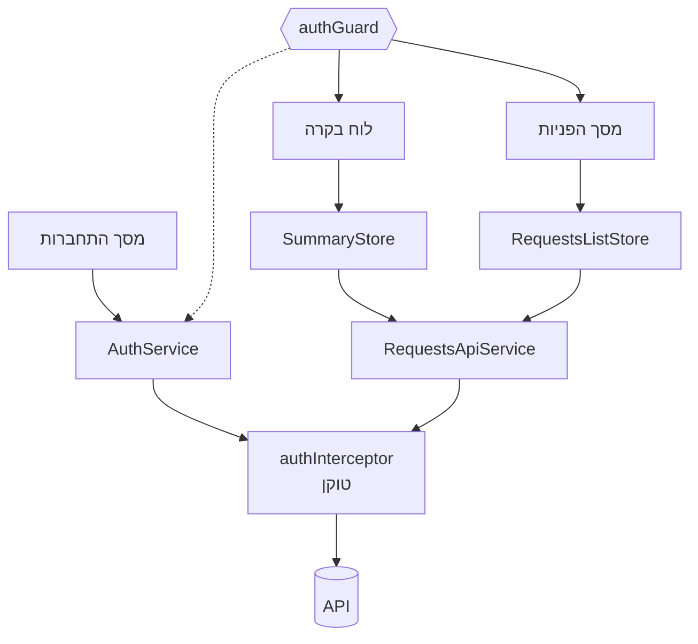
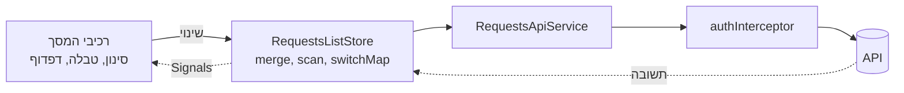
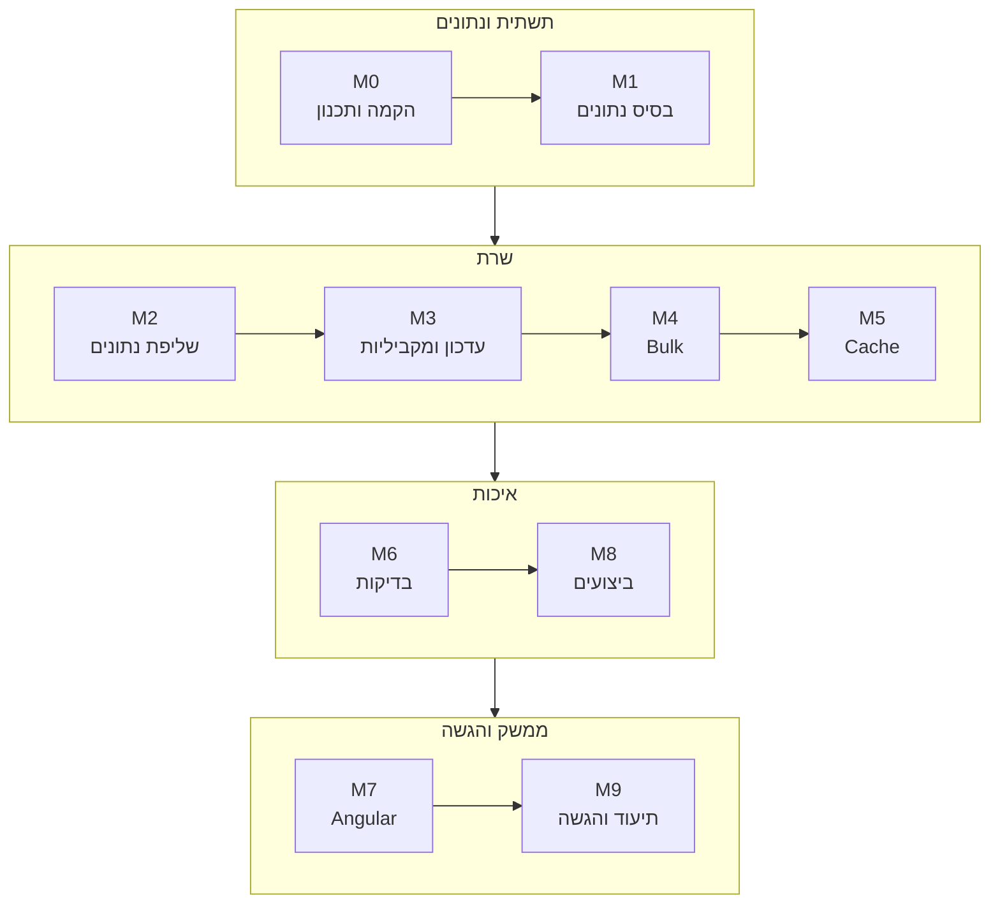

# סיכום הפרויקט – מערכת לניהול פניות

מסמך זה מציג את הפרויקט כולו בקצרה: מה הוא, איך הוא בנוי ועובד, למה נבנה כך ואיך התנהלה העבודה, והיכן נמצא כל דבר. הפירוט המלא נמצא במסמכים שאליהם הוא מפנה.

## תוכן העניינים
1. [על הפרויקט](#על-הפרויקט)
2. [הארכיטקטורה במבט אחד](#הארכיטקטורה-במבט-אחד)
3. [מודל הנתונים ומעברי הסטטוס](#מודל-הנתונים-ומעברי-הסטטוס)
4. [השרת](#השרת)
5. [הלקוח](#הלקוח)
6. [החלטות מרכזיות](#החלטות-מרכזיות)
7. [מגבלות ידועות ובחירות מודעות](#מגבלות-ידועות-ובחירות-מודעות)
8. [תהליך העבודה](#תהליך-העבודה)
9. [מבנה התיקיות](#מבנה-התיקיות)
10. [מפת המסמכים](#מפת-המסמכים)

## על הפרויקט

מערכת לניהול פניות ובקשות המתקבלות מארגונים, לעבודה של כמה משתמשים במקביל מול 100,000 פניות: איתור, סינון, חיפוש, מיון ודפדוף – כולם בצד השרת; עדכון סטטוס עם Optimistic Concurrency והיסטוריית שינויים; עדכון מרוכז (Bulk) של עד 100 פניות; ולוח בקרה עם נתונים מסכמים השמורים ב־Cache. הפתרון בנוי ב־‎.NET 10, ‏Angular 22 ו־SQL Server, ומחולק לשלושה Repos: [requests-management-docs](https://github.com/naomy55978/requests-management-docs) (תכנון ותיעוד – כאן), [requests-management-be](https://github.com/naomy55978/requests-management-be) (Backend) ו־[requests-management-fe](https://github.com/naomy55978/requests-management-fe) (Frontend). המשימות מנוהלות ב־[Project Board](https://github.com/users/naomy55978/projects/2).

## הארכיטקטורה במבט אחד



אפליקציית Angular פונה ל־REST API עם טוקן JWT, וה־API ניגש ל־SQL Server דרך EF Core; כל הסינון, המיון והדפדוף מתבצעים ב־SQL.

## מודל הנתונים ומעברי הסטטוס



‏`Users` הם משתמשי הדמו להתחברות. ‏`AssignedTo` ו־`ChangedBy` שומרים שם משתמש כטקסט, בלי מפתח זר. ‏`RowVersion` הוא הבסיס ל־Concurrency. האינדקסים והנימוק לכל אחד – ב־[PERFORMANCE.md](docs/PERFORMANCE.md).



"הושלמה" הוא מצב סופי, ומעבר לאותו סטטוס חסום ([D‑05](docs/DECISIONS.md#d-05)). מעבר אסור מחזיר `422`. המטריצה מוגדרת במקום אחד בשרת (`StatusTransitions`), ובלקוח יש עותק לתצוגה בלבד ([D‑35](docs/DECISIONS.md#d-35)).

## השרת



ה־Entities הם internal ב־DAL, והשאילתות מחזירות DTOs ישירות ([D‑03](docs/DECISIONS.md#d-03), [D‑04](docs/DECISIONS.md#d-04)).

**הרכיבים העיקריים:**
- `RequestsController`, ‏`AuthController` – ה־Endpoints; פונים רק לממשק של ה־BL.
- `GlobalExceptionHandler` – כל שגיאה חוזרת כ־ProblemDetails עם `traceId`; ניתוק לקוח מסתיים ב־499 בלי שגיאה ביומן.
- `ValidationProblemResponse` – תשובות 400 נקיות: שמות שדות פשוטים (`newStatus`, ‏`items[0].id`) והודעות קריאות, בלי שמות טיפוסים פנימיים של .NET ([D‑18](docs/DECISIONS.md#d-18)).
- `RequestService` – לוגיקת העסק; מתודה אחת לשינוי סטטוס, משותפת לעדכון הבודד ול־Bulk.
- `StatusTransitions` – מטריצת המעברים, במקום אחד.
- `SummaryCache` – ה־Cache של הסיכום: ‏Singleton, ‏60 שניות ומונה "דור" ([D‑20](docs/DECISIONS.md#d-20)).
- `RequestRepository` – שאילתות עם Projection ל־DTO, דפדוף יעיל ב־Deferred Join (דילוג על עמודים באינדקס צר, ושליפת שורות העמוד בלבד), ועדכון סטטוס מותנה עם `OUTPUT`.
- `DatabaseSeeder` – 100,000 פניות דטרמיניסטיות ב־SqlBulkCopy ([D‑13](docs/DECISIONS.md#d-13), [D‑33](docs/DECISIONS.md#d-33)).
- `StartupWarmUp` – חימום הסיכום בעליית השרת, לפני שהוא מתחיל להאזין ([D‑48](docs/DECISIONS.md#d-48)).

**עדכון סטטוס, כולל עדכון מתחרה (409):**



העדכון ושורת ההיסטוריה נכתבים באותה טרנזקציה, וה־DB מבטיח שרק אחד מכמה עדכונים מקבילים עם אותה גרסה יצליח ([D‑06](docs/DECISIONS.md#d-06), [D‑07](docs/DECISIONS.md#d-07)). חוזה ה־API המלא – ב־[API.md](docs/API.md).

## הלקוח



**שירותי הליבה:**
- `AuthService` – ההתחברות והסשן (ב־`sessionStorage`), ובדיקת תוקף במקום אחד ([D‑26](docs/DECISIONS.md#d-26)).
- `authGuard` – מגן על לוח הבקרה ועל מסך הפניות; משתמש לא מחובר מועבר להתחברות.
- `authInterceptor` – מוסיף את הטוקן לקריאות ה־API, ו־401 מוביל להתחברות מחדש.
- `RequestsApiService` – כל הקריאות ל־API של הפניות.
- `SummaryStore`, ‏`RequestsListStore` – מצב המסך; כל אחד מסופק ע״י המסך שלו ונזרק ביציאה ממנו.

**הרכיבים העיקריים:**
- `LoginComponent` – טופס ההתחברות.
- `DashboardPageComponent`, ‏`SummaryCardsComponent` – לוח הבקרה: כרטיסי סיכום וכפתור "רענן".
- `RequestsPageComponent` – מסך הפניות.
- `RequestsFiltersComponent` – סינון וחיפוש.
- `RequestsTableComponent` – הטבלה, מיון ודפדוף, ותפריט שינוי סטטוס לכל שורה.
- `BulkBarComponent`, ‏`BulkResultDialogComponent` – בחירה מרובה ותוצאה לכל פנייה.
- `ConfirmCompleteDialogComponent` – אישור לפני מעבר ל"הושלמה".
- `RequestHistoryDialogComponent` – היסטוריית הסטטוס של פנייה.
- `StateMessageComponent` – הודעות טעינה, ריק ושגיאה.

**זרימת הנתונים במסך הפניות:**



כל שינוי – עמוד, מיון, מסנן או טקסט (אחרי debounce של 300 ms) – מתקפל לשאילתה אחת בזרם RxJS יחיד; `switchMap` מבטל בקשה קודמת שעוד לא חזרה, והתוצאה מגיעה לרכיבים כ־Signals ([D‑27](docs/DECISIONS.md#d-27), [D‑28](docs/DECISIONS.md#d-28)).

## החלטות מרכזיות

כל 48 ההחלטות, עם הסיבה והחלופות שנשקלו – ב־[DECISIONS.md](docs/DECISIONS.md). העיקריות:

- [D‑01](docs/DECISIONS.md#d-01) – **SQL Server:** ‏`rowversion` מובנה ל־Optimistic Concurrency, טרנזקציות ו־Execution Plans ברורים.
- [D‑03](docs/DECISIONS.md#d-03) – **ארבעה פרויקטים בשרת (API, ‏BL, ‏DAL, ‏DTO):** הפרדה מוכרת וברורה, בלי שכבות שרק מעבירות קריאות.
- [D‑06](docs/DECISIONS.md#d-06) – **‏`UPDATE` מותנה, ו־409 לעדכון מתחרה:** האכיפה ב־DB, אטומית, ומונעת Lost Update.
- [D‑08](docs/DECISIONS.md#d-08) – **Bulk עם Partial Success:** כל פנייה עצמאית, וכשל באחת לא מבטל את השאר.
- [D‑10](docs/DECISIONS.md#d-10) – **JWT, ו־`ChangedBy` מתוך הטוקן:** השרת קובע מי שינה, והלקוח לא יכול לזייף.
- [D‑16](docs/DECISIONS.md#d-16) – **שלושה Repos:** מחזור חיים ו־CI נפרדים לכל Stack, ו־Repo תיעוד כנקודת כניסה.
- [D‑20](docs/DECISIONS.md#d-20) – **Cache עם מונה "דור" ו־Invalidation אחרי ה־Commit:** קורא איטי לא משאיר נתון ישן אחרי שינוי.
- [D‑21](docs/DECISIONS.md#d-21) – **בדיקות מול SQL Server אמיתי:** הערבויות המרכזיות (‏`rowversion`, טרנזקציה, אינדקסים) הן של ה־DB.
- [D‑24](docs/DECISIONS.md#d-24) – **דפדוף בשרת ואינדקסים שנבחרו במדידה:** כל אינדקס נבדק ב־logical reads, ב־Execution Plan ובעלות הכתיבה.
- [D‑27](docs/DECISIONS.md#d-27) – **זרם RxJS יחיד עם `switchMap`:** בקשות מיושנות מתבטלות, וכל הסינון נשאר בשרת.
- [D‑43](docs/DECISIONS.md#d-43) – **לוח הבקרה כמסך הפתיחה:** סקירה קודם, והרשימה במרחק לחיצה.
- [D‑48](docs/DECISIONS.md#d-48) – **חימום בעלייה:** הבקשה הראשונה לסיכום מהירה, כי השרת מאזין רק אחרי החימום.

## מגבלות ידועות ובחירות מודעות

ארבע מגבלות שנבחרו במודע בגלל היקף המבדק. הרשימה המלאה – בסוף [DECISIONS.md](docs/DECISIONS.md#מגבלות-ידועות-ושיפורים).

- **חיפוש טקסט חופשי** – `LIKE '%x%'` אינו SARGable: אינדקס לא עוזר, והחיפוש סורק את כל הטבלה (כ־52 ms ב־100,000 פניות, וגדל ליניארית). בקנה מידה גדול: אינדקס n‑grams או Full‑Text ([D‑12](docs/DECISIONS.md#d-12), [D‑24](docs/DECISIONS.md#d-24), [PERFORMANCE.md](docs/PERFORMANCE.md) §7.1).
- **Cache במופע שרת יחיד** – `IMemoryCache` חי בזיכרון של תהליך אחד; בכמה מופעים עלול להישאר summary ישן עד 60 שניות. הפתרונות (Redis, ‏HybridCache, ‏Pub/Sub) מתועדים ב־[CACHE.md](docs/CACHE.md) ולא מומשו ([D‑11](docs/DECISIONS.md#d-11), [D‑20](docs/DECISIONS.md#d-20)).
- **Bulk רציף עם Partial Success** – הפריטים מעובדים אחד אחרי השני, כל אחד בטרנזקציה משלו ובאותה לוגיקה כמו PATCH בודד: אין Deadlock וכשל באחד לא מבטל את השאר. המחיר: הזמן גדל עם מספר הפריטים (כ־0.2 שניות ל־100) ([D‑08](docs/DECISIONS.md#d-08), [D‑19](docs/DECISIONS.md#d-19)).
- **אימות ברמת דמו** – סיסמת דמו אחת, בלי הגבלת ניסיונות, וטוקן JWT תקף 480 דקות (8 שעות) ואינו ניתן לביטול בשרת. התנתקות מכל הלשוניות מטופלת בצד הלקוח (בשינוי נפרד בעבודה); ביטול טוקנים בשרת מחוץ להיקף. בייצור נדרשים סיסמאות אישיות, ‏Rate Limiting, ‏Refresh Tokens ו־Secret Store ([D‑10](docs/DECISIONS.md#d-10)).

## תהליך העבודה



עשרה Milestones בסדר שבו בוצעו; M8 (ביצועים) בוצע לפני M7 (Angular), כדי לסיים את השרת לפני הממשק ([D‑22](docs/DECISIONS.md#d-22)). התלויות, המשימות והערכת המאמץ – ב־[WORK_PLAN.md](docs/WORK_PLAN.md).

**הערכה מול בפועל:** ‏54.5 שעות בהערכה מול 11 שעות בפועל (דיווח עצמי) – הפירוט ב־[WORK_PLAN.md](docs/WORK_PLAN.md#הערכה-מול-בפועל).

**מחזור העבודה בכל משימה:** תוכנית ← אישור מפורש ← ביצוע ← אימות ← Commit עם הפניה ל־Issue, ‏Push ו־CI ירוק.

**שימוש ב־AI:** ‏Claude Code – ‏Opus לתכנון, ארכיטקטורה וסקירה, ו־Sonnet לכתיבת קוד ובדיקות. כל קוד שנכתב אומת בשיטות שלמטה. הפירוט – ב־[README](README.md#שימוש-בכלי-ai).

**שיטות האימות:**
- **Oracle מול SQL** – סקריפט אימות אופציונלי (`scripts/dev/verify-read-api.js` ב־Backend) משווה סינון, חיפוש, מיון ודפדוף לשאילתות SQL ישירות על כל 100,000 הפניות. מקור האמת הן הבדיקות האוטומטיות.
- **Oracle ב־LINQ** – בבדיקות ה־Integration התוצאה הצפויה מחושבת מהנתונים ולא מועתקת מהקוד ([D‑21](docs/DECISIONS.md#d-21)).
- **בדיקות מוטציה** – שוברים את הקוד בכוונה ומוודאים שהבדיקות נכשלות.
- **הוכחת Concurrency** – `ConcurrencyTests`: ‏10 פניות × 20 בקשות PATCH בו־זמנית עם אותה גרסה ← לכל פנייה בדיוק `200` אחד ו־19 תשובות `409`, ושורת היסטוריה אחת; ו־Bulk במקביל ל־PATCH ← מנצח אחד לכל פנייה, בלי 5xx. העדכון ושורת ה־Audit אטומיים (`UpdateAtomicityTests`).
- **דפדפן אמיתי** – ב־Chrome מול ה־API האמיתי, לפני ואחרי כל תיקון בממשק: יישור טקסט מעורב עברית/אנגלית, ניווט ומיקוד מקלדת, וזמן הבקשה הראשונה לסיכום (78–105 ms אחרי החימום).
- **בדיקה מקצה לקצה** – מ־clone נקי על LocalDB קר, כמו בודק ([SUBMISSION_CHECK.md](docs/SUBMISSION_CHECK.md)): בבדיקה מ־26.10.2026: ‏145 בדיקות Backend, ‏367 בדיקות Frontend ומעבר של 21/21 בדפדפן. סך הבדיקות האוטומטיות היום: ‏159 + 376 = 535.

## מבנה התיקיות

```
requests-management-docs/          תכנון ותיעוד
  README.md                        נקודת הכניסה לבודקים
  PROJECT_SUMMARY.md               מסמך זה
  docs/                            החלטות, API, ביצועים, Cache, תוכנית עבודה, בדיקת הגשה
    performance/                   תוצאות המדידות ו־Execution Plans: before, after-indexes, final, alternatives, seed-v2-hebrew

requests-management-be/            Backend
  RequestsManagement.sln, global.json, dotnet-tools.json
  .github/workflows/               CI: build ובדיקות מול SQL Server בקונטיינר
  scripts/                         מדידת שאילתות (MeasureQueries.cs)
    dev/                           אופציונלי: verify-read-api.js – ה־API מול SQL ישיר על 100,000 הפניות
  src/
    RequestsManagement.API/        Controllers, Middleware, ‏Auth, ‏Startup, ‏Program.cs
    RequestsManagement.BL/         RequestService, ‏StatusTransitions, ‏SummaryCache, ‏AuthService
    RequestsManagement.DAL/        Entities, ‏Configurations, ‏Migrations, ‏Seeding, ‏RequestRepository
    RequestsManagement.DTO/        מודלי בקשה ותשובה, Enums
  tests/RequestsManagement.Tests/
    Unit/                          בדיקות יחידה
    Integration/                   בדיקות דרך ה־API מול SQL Server, ותשתית הבדיקות

requests-management-fe/            Frontend
  .github/workflows/               CI: lint, בדיקות ו־build
  angular.json, package.json, proxy.conf.json
  src/app/
    core/                          API, התחברות, עברית, אייקונים, ניתוב
    features/                      המסכים: login, ‏dashboard, ‏requests
    shared/                        רכיבי תצוגה משותפים: תגי סטטוס ועדיפות, הודעות מצב
```

## מפת המסמכים

| נושא | מסמך |
|---|---|
| הרצה, בדיקות, מבנה, מפת דרישות ושימוש ב־AI | [README.md](README.md) |
| כל ההחלטות, עם סיבה וחלופות, ומגבלות ידועות | [docs/DECISIONS.md](docs/DECISIONS.md) |
| חוזה ה־API, ‏Bulk וקודי שגיאה | [docs/API.md](docs/API.md) |
| אינדקסים, Execution Plans ו־Bottleneck | [docs/PERFORMANCE.md](docs/PERFORMANCE.md) |
| ה־Cache, ה־Invalidation וריבוי מופעים | [docs/CACHE.md](docs/CACHE.md) |
| Milestones, משימות, הערכות ומיפוי בדיקות לדרישות | [docs/WORK_PLAN.md](docs/WORK_PLAN.md) |
| תוצאות המדידות הגולמיות ומדריך לתיקיות | [docs/PERFORMANCE.md – נספח ב'](docs/PERFORMANCE.md#נספח-ב--הקבצים) |
| הבדיקה מקצה לקצה מ־clone נקי | [docs/SUBMISSION_CHECK.md](docs/SUBMISSION_CHECK.md) |
| הרצת ה־Backend וסקריפטי האימות | [README של ה־Backend](https://github.com/naomy55978/requests-management-be#readme) |
| הרצת ה־Frontend | [README של ה־Frontend](https://github.com/naomy55978/requests-management-fe#readme) |
