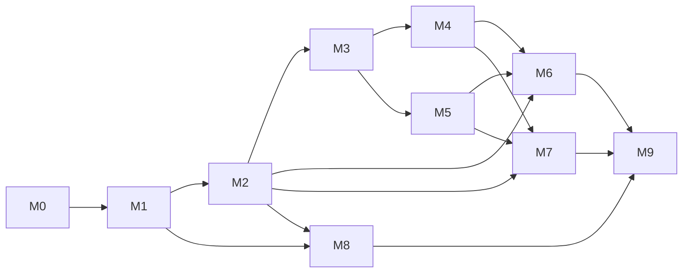

# תוכנית עבודה

תוכנית העבודה מנוהלת ב־GitHub: 
[Issues](https://github.com/naomy55978/requests-management/issues), [Milestones](https://github.com/naomy55978/requests-management/milestones) ו־[Project Board](https://github.com/users/naomy55978/projects/2).
מסמך זה הוא תמונת מצב של התכנון: חלוקה ל־Milestones, משימות, תלויות, הערכות מאמץ, והקשר בין דרישות המבדק למשימות.

**עקרונות החלוקה**
- כל Milestone מסתיים במצב שניתן לבנות, להריץ ולבדוק.
- לכל Issue: תיאור, תוצר מצופה, קריטריוני קבלה, הערכת מאמץ, תלויות (גם כקשרי *blocked by* ב־GitHub) וסעיף המבדק שהוא מכסה.
- משימות שאינן קוד (תכנון, אימות נתונים, מדידות, תיעוד, הכנה להגשה) מסומנות ב־Label `non-code`.
- כל Issue מסומן ב־Label `req-*` לפי סעיף המבדק – כך ניתן לסנן ב־GitHub את כל המשימות של דרישה מסוימת.

## Milestones וסדר ביצוע

| Milestone | נושא | תוצר | מאמץ | תלוי ב־ |
|---|---|---|---|---|
| M0 | הקמה ותכנון | Repo שעובר build ב־CI | 3 ש' | – |
| M1 | DB ונתונים | DB עם 100K רשומות | 4 ש' | M0 |
| M2 | API שליפה | GET פעיל + Swagger | 6 ש' | M1 |
| M3 | עדכון ו־Concurrency | עדכון בטוח | 5 ש' | M2 |
| M4 | Bulk | Endpoint + תיעוד | 3 ש' | M3 |
| M5 | Cache | Cache מתועד | 2 ש' | M3 |
| M6 | בדיקות | בדיקות ירוקות ב־CI | 5 ש' | M2–M5 |
| M7 | Angular | UI מלא | 12 ש' | M2–M5 |
| M8 | ביצועים | PERFORMANCE.md | 3 ש' | M1–M2 |
| M9 | תיעוד והגשה | הגשה מלאה | 4 ש' | הכל |
| | **סה"כ** | | **47 ש'** | |

M4 (Bulk) ו־M5 (Cache) תלויים שניהם רק ב־M3 וניתן לבצעם בכל סדר. M8 (ביצועים) יכול להתבצע במקביל ל־M3–M7.

## משימות

### M0 – הקמה ותכנון (3 ש')

| Issue | משימה | מאמץ | תלוי ב־ | סעיף במבדק |
|---|---|---|---|---|
| [#1](https://github.com/naomy55978/requests-management/issues/1) | בדיקת סביבה והתחברות ל-GitHub | 0.25 | – | §9 תכנון עבודה (היערכות להרצה) |
| [#2](https://github.com/naomy55978/requests-management/issues/2) | שלד Solution: 4 פרויקטי Backend + פרויקט בדיקות, הפניות, .gitignore, global.json | 1 | [#1](https://github.com/naomy55978/requests-management/issues/1) | §10 איכות הקוד (מבנה פרויקט והפרדת אחריות) |
| [#3](https://github.com/naomy55978/requests-management/issues/3) | CI: GitHub Actions שמריץ build בכל push/PR | 0.5 | [#2](https://github.com/naomy55978/requests-management/issues/2) | §10 איכות הקוד, §11 תיעוד (הוראות הפעלה) |
| [#4](https://github.com/naomy55978/requests-management/issues/4) | תכנון: Milestones, Labels, Project Board ו-Issues | 0.75 | [#1](https://github.com/naomy55978/requests-management/issues/1) | §9 תכנון עבודה וחלוקה למשימות |
| [#5](https://github.com/naomy55978/requests-management/issues/5) | שלד תיעוד: docs/DECISIONS.md (D-01..D-15) ו-docs/WORK_PLAN.md | 0.5 | [#4](https://github.com/naomy55978/requests-management/issues/4) | §9 תכנון עבודה, §11 תיעוד (החלטות וחלופות) |

### M1 – DB ונתונים (4 ש')

| Issue | משימה | מאמץ | תלוי ב־ | סעיף במבדק |
|---|---|---|---|---|
| [#6](https://github.com/naomy55978/requests-management/issues/6) | Entities, Enums ו-AppDbContext (כולל RowVersion) | 1 | [#2](https://github.com/naomy55978/requests-management/issues/2) | מבנה פנייה, §1 שליפת נתונים |
| [#7](https://github.com/naomy55978/requests-management/issues/7) | Migration ראשוני + אינדקסים עם נימוק | 1 | [#6](https://github.com/naomy55978/requests-management/issues/6) | §1 (תיעוד אינדקסים), §6 ביצועים |
| [#8](https://github.com/naomy55978/requests-management/issues/8) | Seeder: 100,000 רשומות עם SqlBulkCopy, Seed קבוע, --reset ומשתמשי דמו | 1.5 | [#7](https://github.com/naomy55978/requests-management/issues/7) | מבנה פנייה (100K רשומות ויצירה חוזרת) |
| [#9](https://github.com/naomy55978/requests-management/issues/9) | אימות הנתונים שנוצרו (ספירות והתפלגויות) | 0.5 | [#8](https://github.com/naomy55978/requests-management/issues/8) | §6 ביצועים (בסיס 100K רשומות) |

### M2 – API שליפה (6 ש')

| Issue | משימה | מאמץ | תלוי ב־ | סעיף במבדק |
|---|---|---|---|---|
| [#10](https://github.com/naomy55978/requests-management/issues/10) | DTOs: RequestFilter, PagedResult, פריט רשימה, פרטי פנייה, Summary | 0.75 | [#2](https://github.com/naomy55978/requests-management/issues/2) | §1 (החזרת DTOs), §10 (DTOs / Mapping) |
| [#11](https://github.com/naomy55978/requests-management/issues/11) | Repository: שאילתת רשימה עם סינון, חיפוש, מיון, דפדוף ו-Projection | 1.5 | [#7](https://github.com/naomy55978/requests-management/issues/7), [#10](https://github.com/naomy55978/requests-management/issues/10) | §1 שליפת נתונים, §6 (אין טעינה מלאה לפני Pagination) |
| [#12](https://github.com/naomy55978/requests-management/issues/12) | Service ו-Validation לפרמטרי השליפה | 1 | [#11](https://github.com/naomy55978/requests-management/issues/11) | §1 (הגבלת Page Size ו-Validation), §10 (Validation עקבי) |
| [#13](https://github.com/naomy55978/requests-management/issues/13) | Controllers: GET רשימה ו-GET לפי מזהה + OpenAPI/Swagger | 0.75 | [#12](https://github.com/naomy55978/requests-management/issues/12) | §1 שליפת נתונים |
| [#14](https://github.com/naomy55978/requests-management/issues/14) | טיפול שגיאות גלובלי (ProblemDetails) ו-Logging | 1 | [#13](https://github.com/naomy55978/requests-management/issues/13) | §10 (Global Error Handling / ProblemDetails, Logging) |
| [#15](https://github.com/naomy55978/requests-management/issues/15) | Endpoint summary: Aggregations | 1 | [#11](https://github.com/naomy55978/requests-management/issues/11) | §1 (לפחות שני Aggregations) |

### M3 – עדכון ו־Concurrency (5 ש')

| Issue | משימה | מאמץ | תלוי ב־ | סעיף במבדק |
|---|---|---|---|---|
| [#16](https://github.com/naomy55978/requests-management/issues/16) | חוקי מעברי סטטוס במקום אחד ב-BL | 0.5 | [#12](https://github.com/naomy55978/requests-management/issues/12) | §2 (מעבר סטטוס שאינו מותר – Validation ברור) |
| [#17](https://github.com/naomy55978/requests-management/issues/17) | אימות JWT: התחברות עם משתמשי דמו ו-ChangedBy מה-Claims | 1.25 | [#8](https://github.com/naomy55978/requests-management/issues/8), [#14](https://github.com/naomy55978/requests-management/issues/14) | §3 היסטוריית שינויים (ChangedBy) |
| [#18](https://github.com/naomy55978/requests-management/issues/18) | עדכון מותנה + Audit באותה טרנזקציה; 404/409/422 | 2 | [#16](https://github.com/naomy55978/requests-management/issues/16) | §2 Optimistic Concurrency, §3 Audit |
| [#19](https://github.com/naomy55978/requests-management/issues/19) | Endpoints: PATCH status ו-GET history | 1.25 | [#17](https://github.com/naomy55978/requests-management/issues/17), [#18](https://github.com/naomy55978/requests-management/issues/18) | §2, §3 (Endpoint לצפייה בהיסטוריה) |

### M4 – Bulk (3 ש')

| Issue | משימה | מאמץ | תלוי ב־ | סעיף במבדק |
|---|---|---|---|---|
| [#20](https://github.com/naomy55978/requests-management/issues/20) | חוזה Bulk ו-Validation (עד 100 פריטים) | 1 | [#19](https://github.com/naomy55978/requests-management/issues/19) | §4 פעולת Bulk |
| [#21](https://github.com/naomy55978/requests-management/issues/21) | מימוש Bulk: טרנזקציה לכל פריט ותוצאה לכל פריט (Partial Success) | 1.5 | [#20](https://github.com/naomy55978/requests-management/issues/20) | §4 פעולת Bulk, §2 Concurrency |
| [#22](https://github.com/naomy55978/requests-management/issues/22) | תיעוד התנהגות Bulk (docs/API.md) | 0.5 | [#21](https://github.com/naomy55978/requests-management/issues/21) | §4 (להגדיר ולתעד התנהגות), §11 (הסבר על Bulk) |

### M5 – Cache (2 ש')

| Issue | משימה | מאמץ | תלוי ב־ | סעיף במבדק |
|---|---|---|---|---|
| [#23](https://github.com/naomy55978/requests-management/issues/23) | Cache ל-summary עם IMemoryCache ו-Expiration של 60 שניות | 0.75 | [#15](https://github.com/naomy55978/requests-management/issues/15) | §7 Cache (Expiration) |
| [#24](https://github.com/naomy55978/requests-management/issues/24) | Invalidation של ה-Cache בכל שינוי סטטוס (בודד ו-Bulk) | 0.75 | [#19](https://github.com/naomy55978/requests-management/issues/19), [#21](https://github.com/naomy55978/requests-management/issues/21), [#23](https://github.com/naomy55978/requests-management/issues/23) | §7 Cache (מניעת מידע מיושן) |
| [#25](https://github.com/naomy55978/requests-management/issues/25) | תיעוד ה-Cache: נימוק, Invalidation ו-Scale-out | 0.5 | [#24](https://github.com/naomy55978/requests-management/issues/24) | §7 (נימוק, מספר מופעי שרת), §11 |

### M6 – בדיקות (5 ש')

| Issue | משימה | מאמץ | תלוי ב־ | סעיף במבדק |
|---|---|---|---|---|
| [#26](https://github.com/naomy55978/requests-management/issues/26) | תשתית בדיקות: DB זמני לכל ריצה ו-WebApplicationFactory | 1.25 | [#14](https://github.com/naomy55978/requests-management/issues/14) | §8 בדיקות (Integration הכולל API ו-DB) |
| [#27](https://github.com/naomy55978/requests-management/issues/27) | בדיקות יחידה: מעברי סטטוס ו-Validation | 0.75 | [#16](https://github.com/naomy55978/requests-management/issues/16), [#26](https://github.com/naomy55978/requests-management/issues/26) | §8 (Validation / קלט לא תקין) |
| [#28](https://github.com/naomy55978/requests-management/issues/28) | בדיקות Integration: שליפה וסינון, PATCH עם 404/409/422 | 1 | [#19](https://github.com/naomy55978/requests-management/issues/19), [#26](https://github.com/naomy55978/requests-management/issues/26) | §8 (תרחיש תקין של שליפה/סינון או עדכון, Integration) |
| [#29](https://github.com/naomy55978/requests-management/issues/29) | בדיקת Concurrency: עדכונים מקבילים – אחד מצליח והשני מקבל 409 | 0.75 | [#28](https://github.com/naomy55978/requests-management/issues/28) | §8 (Concurrency Conflict), §2 (אין Lost Update) |
| [#30](https://github.com/naomy55978/requests-management/issues/30) | בדיקות Bulk ו-Invalidation של ה-Cache | 0.5 | [#21](https://github.com/naomy55978/requests-management/issues/21), [#24](https://github.com/naomy55978/requests-management/issues/24), [#26](https://github.com/naomy55978/requests-management/issues/26) | §8, §4, §7 |
| [#31](https://github.com/naomy55978/requests-management/issues/31) | CI: SQL Server בקונטיינר והרצת הבדיקות | 0.75 | [#3](https://github.com/naomy55978/requests-management/issues/3), [#26](https://github.com/naomy55978/requests-management/issues/26) | §8 בדיקות |

### M7 – Angular (12 ש')

| Issue | משימה | מאמץ | תלוי ב־ | סעיף במבדק |
|---|---|---|---|---|
| [#32](https://github.com/naomy55978/requests-management/issues/32) | שלד Angular 22 + Angular Material + Proxy והגדרות סביבה | 1 | [#13](https://github.com/naomy55978/requests-management/issues/13) | §5 Angular |
| [#33](https://github.com/naomy55978/requests-management/issues/33) | מסך התחברות, AuthService ו-Interceptor ל-JWT ולשגיאות | 1.5 | [#17](https://github.com/naomy55978/requests-management/issues/17), [#32](https://github.com/naomy55978/requests-management/issues/32) | §5 Angular |
| [#34](https://github.com/naomy55978/requests-management/issues/34) | מסך רשימת פניות: mat-table, mat-paginator, mat-sort – בצד השרת | 2.5 | [#33](https://github.com/naomy55978/requests-management/issues/33) | §5 (חיפוש, סינון, מיון ודפדוף בצד השרת) |
| [#35](https://github.com/naomy55978/requests-management/issues/35) | טופס סינון וחיפוש עם debounce ו-switchMap | 1.5 | [#34](https://github.com/naomy55978/requests-management/issues/34) | §5 (Debounce, ביטול/החלפת בקשות קודמות) |
| [#36](https://github.com/naomy55978/requests-management/issues/36) | מצבי Loading, Empty ו-Error | 0.75 | [#34](https://github.com/naomy55978/requests-management/issues/34) | §5 (Loading, Empty State ו-Error State) |
| [#37](https://github.com/naomy55978/requests-management/issues/37) | כרטיסי Summary (Aggregations) | 0.75 | [#15](https://github.com/naomy55978/requests-management/issues/15), [#33](https://github.com/naomy55978/requests-management/issues/33) | §5 (הצגת Aggregations) |
| [#38](https://github.com/naomy55978/requests-management/issues/38) | עדכון סטטוס עם טיפול ב-409 (הודעה ורענון השורה) | 1.5 | [#19](https://github.com/naomy55978/requests-management/issues/19), [#34](https://github.com/naomy55978/requests-management/issues/34) | §5 (עדכון סטטוס וטיפול ב-409 Conflict) |
| [#39](https://github.com/naomy55978/requests-management/issues/39) | בחירה מרובה ו-Bulk עם הצגת תוצאה לכל פריט | 1.5 | [#21](https://github.com/naomy55978/requests-management/issues/21), [#34](https://github.com/naomy55978/requests-management/issues/34) | §5, §4 (תשובה ברורה ללקוח) |
| [#40](https://github.com/naomy55978/requests-management/issues/40) | חלון היסטוריית שינויים | 0.75 | [#19](https://github.com/naomy55978/requests-management/issues/19), [#34](https://github.com/naomy55978/requests-management/issues/34) | §5 (צפייה בהיסטוריית שינויים), §3 |
| [#41](https://github.com/naomy55978/requests-management/issues/41) | סקירת קוד ה-UI: הפרדת Components ו-Services | 0.25 | [#35](https://github.com/naomy55978/requests-management/issues/35), [#36](https://github.com/naomy55978/requests-management/issues/36), [#37](https://github.com/naomy55978/requests-management/issues/37), [#38](https://github.com/naomy55978/requests-management/issues/38), [#39](https://github.com/naomy55978/requests-management/issues/39), [#40](https://github.com/naomy55978/requests-management/issues/40) | §5 (הפרדת אחריות), §10 |

### M8 – ביצועים (3 ש')

| Issue | משימה | מאמץ | תלוי ב־ | סעיף במבדק |
|---|---|---|---|---|
| [#42](https://github.com/naomy55978/requests-management/issues/42) | מדידת בסיס: STATISTICS IO/TIME ו-Execution Plan לשתי פעולות | 1 | [#9](https://github.com/naomy55978/requests-management/issues/9), [#11](https://github.com/naomy55978/requests-management/issues/11) | §6 ביצועים (Execution Plan או מדד מקביל) |
| [#43](https://github.com/naomy55978/requests-management/issues/43) | כוונון אינדקסים ומדידה חוזרת (לפני/אחרי) | 1 | [#42](https://github.com/naomy55978/requests-management/issues/42) | §6 (פירוט האינדקסים והסיבה) |
| [#44](https://github.com/naomy55978/requests-management/issues/44) | ניתוח Bottleneck וכתיבת docs/PERFORMANCE.md | 1 | [#43](https://github.com/naomy55978/requests-management/issues/43) | §6 (Bottleneck והצעת שיפור), §1 (תיעוד מניעת טעינה מלאה), §11 |

### M9 – תיעוד והגשה (4 ש')

| Issue | משימה | מאמץ | תלוי ב־ | סעיף במבדק |
|---|---|---|---|---|
| [#45](https://github.com/naomy55978/requests-management/issues/45) | README בעברית: הקמה, הרצה, טכנולוגיות ומבנה | 1.25 | [#31](https://github.com/naomy55978/requests-management/issues/31), [#41](https://github.com/naomy55978/requests-management/issues/41) | §11 תיעוד הפתרון |
| [#46](https://github.com/naomy55978/requests-management/issues/46) | השלמת DECISIONS.md: חלופות, מגבלה ידועה ושיפור | 0.75 | [#25](https://github.com/naomy55978/requests-management/issues/25), [#44](https://github.com/naomy55978/requests-management/issues/44) | §11 (שתי החלטות וחלופות, מגבלה ושיפור) |
| [#47](https://github.com/naomy55978/requests-management/issues/47) | תיעוד השימוש בכלי AI | 0.5 | [#45](https://github.com/naomy55978/requests-management/issues/45) | §11 (פירוט שימוש בכלי AI) |
| [#48](https://github.com/naomy55978/requests-management/issues/48) | בדיקה מקצה לקצה מ-clone נקי | 1 | [#45](https://github.com/naomy55978/requests-management/issues/45) | אופן ההגשה (אפשר בחינה והרצה) |
| [#49](https://github.com/naomy55978/requests-management/issues/49) | גישת הבודקים ל-Repo ורשימת הגשה | 0.5 | [#48](https://github.com/naomy55978/requests-management/issues/48) | אופן ההגשה (נגישות הפתרון, לא ZIP) |

## מטריצת מעקב: דרישה ← משימות

| סעיף במבדק | Label | Issues |
|---|---|---|
| מבנה פנייה ונתוני בדיקה (100K, יצירה חוזרת) | `req-entity` | [#6](https://github.com/naomy55978/requests-management/issues/6), [#8](https://github.com/naomy55978/requests-management/issues/8) |
| §1 שליפת נתונים | `req-01-retrieval` | [#6](https://github.com/naomy55978/requests-management/issues/6), [#7](https://github.com/naomy55978/requests-management/issues/7), [#10](https://github.com/naomy55978/requests-management/issues/10), [#11](https://github.com/naomy55978/requests-management/issues/11), [#12](https://github.com/naomy55978/requests-management/issues/12), [#13](https://github.com/naomy55978/requests-management/issues/13), [#15](https://github.com/naomy55978/requests-management/issues/15), [#28](https://github.com/naomy55978/requests-management/issues/28), [#34](https://github.com/naomy55978/requests-management/issues/34), [#44](https://github.com/naomy55978/requests-management/issues/44) |
| §2 עדכון סטטוס ותחרותיות | `req-02-concurrency` | [#16](https://github.com/naomy55978/requests-management/issues/16), [#18](https://github.com/naomy55978/requests-management/issues/18), [#19](https://github.com/naomy55978/requests-management/issues/19), [#21](https://github.com/naomy55978/requests-management/issues/21), [#28](https://github.com/naomy55978/requests-management/issues/28), [#29](https://github.com/naomy55978/requests-management/issues/29), [#38](https://github.com/naomy55978/requests-management/issues/38) |
| §3 היסטוריית שינויים | `req-03-audit` | [#17](https://github.com/naomy55978/requests-management/issues/17), [#18](https://github.com/naomy55978/requests-management/issues/18), [#19](https://github.com/naomy55978/requests-management/issues/19), [#40](https://github.com/naomy55978/requests-management/issues/40) |
| §4 פעולת Bulk | `req-04-bulk` | [#20](https://github.com/naomy55978/requests-management/issues/20), [#21](https://github.com/naomy55978/requests-management/issues/21), [#22](https://github.com/naomy55978/requests-management/issues/22), [#30](https://github.com/naomy55978/requests-management/issues/30), [#39](https://github.com/naomy55978/requests-management/issues/39) |
| §5 Angular | `req-05-angular` | [#32](https://github.com/naomy55978/requests-management/issues/32), [#33](https://github.com/naomy55978/requests-management/issues/33), [#34](https://github.com/naomy55978/requests-management/issues/34), [#35](https://github.com/naomy55978/requests-management/issues/35), [#36](https://github.com/naomy55978/requests-management/issues/36), [#37](https://github.com/naomy55978/requests-management/issues/37), [#38](https://github.com/naomy55978/requests-management/issues/38), [#39](https://github.com/naomy55978/requests-management/issues/39), [#40](https://github.com/naomy55978/requests-management/issues/40), [#41](https://github.com/naomy55978/requests-management/issues/41) |
| §6 ביצועים | `req-06-performance` | [#7](https://github.com/naomy55978/requests-management/issues/7), [#9](https://github.com/naomy55978/requests-management/issues/9), [#11](https://github.com/naomy55978/requests-management/issues/11), [#42](https://github.com/naomy55978/requests-management/issues/42), [#43](https://github.com/naomy55978/requests-management/issues/43), [#44](https://github.com/naomy55978/requests-management/issues/44) |
| §7 Cache | `req-07-cache` | [#23](https://github.com/naomy55978/requests-management/issues/23), [#24](https://github.com/naomy55978/requests-management/issues/24), [#25](https://github.com/naomy55978/requests-management/issues/25), [#30](https://github.com/naomy55978/requests-management/issues/30) |
| §8 בדיקות אוטומטיות | `req-08-tests` | [#26](https://github.com/naomy55978/requests-management/issues/26), [#27](https://github.com/naomy55978/requests-management/issues/27), [#28](https://github.com/naomy55978/requests-management/issues/28), [#29](https://github.com/naomy55978/requests-management/issues/29), [#30](https://github.com/naomy55978/requests-management/issues/30), [#31](https://github.com/naomy55978/requests-management/issues/31) |
| §9 תכנון עבודה וחלוקה למשימות | `req-09-planning` | [#1](https://github.com/naomy55978/requests-management/issues/1), [#4](https://github.com/naomy55978/requests-management/issues/4), [#5](https://github.com/naomy55978/requests-management/issues/5) |
| §10 איכות הקוד | `req-10-quality` | [#2](https://github.com/naomy55978/requests-management/issues/2), [#3](https://github.com/naomy55978/requests-management/issues/3), [#10](https://github.com/naomy55978/requests-management/issues/10), [#12](https://github.com/naomy55978/requests-management/issues/12), [#14](https://github.com/naomy55978/requests-management/issues/14), [#41](https://github.com/naomy55978/requests-management/issues/41) |
| §11 תיעוד הפתרון | `req-11-docs` | [#3](https://github.com/naomy55978/requests-management/issues/3), [#5](https://github.com/naomy55978/requests-management/issues/5), [#22](https://github.com/naomy55978/requests-management/issues/22), [#25](https://github.com/naomy55978/requests-management/issues/25), [#44](https://github.com/naomy55978/requests-management/issues/44), [#45](https://github.com/naomy55978/requests-management/issues/45), [#46](https://github.com/naomy55978/requests-management/issues/46), [#47](https://github.com/naomy55978/requests-management/issues/47) |
| אופן ההגשה | `req-submission` | [#48](https://github.com/naomy55978/requests-management/issues/48), [#49](https://github.com/naomy55978/requests-management/issues/49) |
