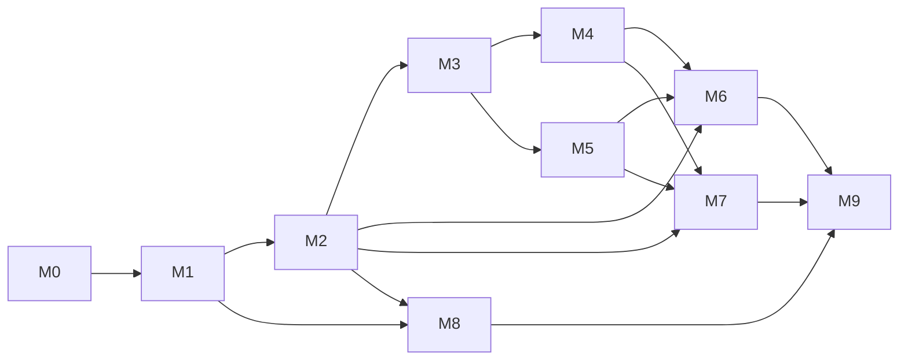

# תוכנית עבודה

תוכנית העבודה מנוהלת ב־GitHub: 
[Issues](https://github.com/naomy55978/requests-management-docs/issues), [Milestones](https://github.com/naomy55978/requests-management-docs/milestones) ו־[Project Board](https://github.com/users/naomy55978/projects/2).
מסמך זה הוא תמונת מצב של התכנון: חלוקה ל־Milestones, משימות, תלויות, הערכות מאמץ, והקשר בין דרישות המבדק למשימות.

**עקרונות החלוקה**
- כל Milestone מסתיים במצב שניתן לבנות, להריץ ולבדוק.
- לכל Issue: תיאור, תוצר מצופה, קריטריוני קבלה, הערכת מאמץ, תלויות (גם כקשרי *blocked by* ב־GitHub) וסעיף המבדק שהוא מכסה.
- משימות שאינן קוד (תכנון, אימות נתונים, מדידות, תיעוד, הכנה להגשה) מסומנות ב־Label `non-code`.
- כל Issue מסומן ב־Label `req-*` לפי סעיף המבדק – כך ניתן לסנן ב־GitHub את כל המשימות של דרישה מסוימת.

## מבנה ה־Repos

הפתרון מחולק לשלושה Repos (החלטה D‑16), כולם מקושרים לאותו Project Board:

| Repo | תוכן |
|---|---|
| [requests-management-docs](https://github.com/naomy55978/requests-management-docs) | תכנון ותיעוד: Issues, Milestones, מסמך זה, החלטות, ביצועים, API |
| [requests-management-be](https://github.com/naomy55978/requests-management-be) | Backend: ‏Solution, ‏`src/`, ‏`tests/`, ‏CI |
| [requests-management-fe](https://github.com/naomy55978/requests-management-fe) | Frontend: אפליקציית Angular בשורש ה־Repo (נוצרת ב־M7) |

**מוסכמת סגירת Issues:** כל ה־Issues נמצאים ב־`requests-management-docs`. Commit ב־Repo של ה־Backend או ה־Frontend סוגר Issue עם הפניה מלאה, למשל:

```
Closes naomy55978/requests-management-docs#12
```

הפניה קצרה (`#12`) ב־Repo של הקוד מפנה ל־Repo הלא נכון ולא תסגור את ה־Issue. ב־Repo התיעוד עצמו מספיק `Closes #12`.

## Milestones וסדר ביצוע

| Milestone | נושא | תוצר | מאמץ | תלוי ב־ |
|---|---|---|---|---|
| M0 | הקמה ותכנון | שלושה Repos; Backend שעובר build ב־CI | 3.75 ש' | – |
| M1 | DB ונתונים | DB עם 100K רשומות | 4 ש' | M0 |
| M2 | API שליפה | GET פעיל + Swagger | 6 ש' | M1 |
| M3 | עדכון ו־Concurrency | עדכון בטוח | 5 ש' | M2 |
| M4 | Bulk | Endpoint + תיעוד | 3 ש' | M3 |
| M5 | Cache | Cache מתועד | 2 ש' | M3 |
| M6 | בדיקות | בדיקות ירוקות ב־CI | 5 ש' | M2–M5 |
| M7 | Angular | UI מלא | 12 ש' | M2–M5 |
| M8 | ביצועים | PERFORMANCE.md + כותרת Server-Timing | 5 ש' | M1–M2 |
| M9 | תיעוד והגשה | הגשה מלאה | 7.25 ש' (במקור 4) | הכל |
| | **סה"כ** | | **53 ש'** | |

M0 כולל 0.75 ש' שלא תוכננו מראש עבור פיצול הפתרון לשלושה Repos (#50).

M8 הורחב מ־3 ל־5 ש' (עודכן 23.10.2026): סקירת כל אינדקס קיים מ־M1 עם ניסוי ביטול ומדידת עלות הכתיבה (W1) – ‏0.25 ש' ל־#42 ו־0.25 ש' ל־#43; כותרת `Server-Timing` (D‑23, הוחלטה אחרי התכנון המקורי) – Issue חדש #51, ‏1.5 ש'. שאר התכנון ללא שינוי.



M4 (Bulk) ו־M5 (Cache) תלויים שניהם רק ב־M3 וניתן לבצעם בכל סדר. M8 (ביצועים) יכול להתבצע במקביל ל־M3–M7.

## משימות

### M0 – הקמה ותכנון (3.75 ש')

| Issue | משימה | מאמץ | תלוי ב־ | סעיף במבדק |
|---|---|---|---|---|
| [#1](https://github.com/naomy55978/requests-management-docs/issues/1) | בדיקת סביבה והתחברות ל-GitHub | 0.25 | – | §9 תכנון עבודה (היערכות להרצה) |
| [#2](https://github.com/naomy55978/requests-management-docs/issues/2) | שלד Solution: 4 פרויקטי Backend + פרויקט בדיקות, הפניות, .gitignore, global.json | 1 | [#1](https://github.com/naomy55978/requests-management-docs/issues/1) | §10 איכות הקוד (מבנה פרויקט והפרדת אחריות) |
| [#3](https://github.com/naomy55978/requests-management-docs/issues/3) | CI: GitHub Actions שמריץ build בכל push/PR | 0.5 | [#2](https://github.com/naomy55978/requests-management-docs/issues/2) | §10 איכות הקוד, §11 תיעוד (הוראות הפעלה) |
| [#4](https://github.com/naomy55978/requests-management-docs/issues/4) | תכנון: Milestones, Labels, Project Board ו-Issues | 0.75 | [#1](https://github.com/naomy55978/requests-management-docs/issues/1) | §9 תכנון עבודה וחלוקה למשימות |
| [#5](https://github.com/naomy55978/requests-management-docs/issues/5) | שלד תיעוד: docs/DECISIONS.md (D-01..D-15) ו-docs/WORK_PLAN.md | 0.5 | [#4](https://github.com/naomy55978/requests-management-docs/issues/4) | §9 תכנון עבודה, §11 תיעוד (החלטות וחלופות) |
| [#50](https://github.com/naomy55978/requests-management-docs/issues/50) | פיצול לשלושה Repos: docs, be, fe (D-16) | 0.75 | [#2](https://github.com/naomy55978/requests-management-docs/issues/2), [#3](https://github.com/naomy55978/requests-management-docs/issues/3), [#4](https://github.com/naomy55978/requests-management-docs/issues/4), [#5](https://github.com/naomy55978/requests-management-docs/issues/5) | §9 תכנון עבודה, §10 איכות הקוד (מבנה פרויקט), אופן ההגשה |

### M1 – DB ונתונים (4 ש')

| Issue | משימה | מאמץ | תלוי ב־ | סעיף במבדק |
|---|---|---|---|---|
| [#6](https://github.com/naomy55978/requests-management-docs/issues/6) | Entities, Enums ו-AppDbContext (כולל RowVersion) | 1 | [#2](https://github.com/naomy55978/requests-management-docs/issues/2) | מבנה פנייה, §1 שליפת נתונים |
| [#7](https://github.com/naomy55978/requests-management-docs/issues/7) | Migration ראשוני + אינדקסים עם נימוק | 1 | [#6](https://github.com/naomy55978/requests-management-docs/issues/6) | §1 (תיעוד אינדקסים), §6 ביצועים |
| [#8](https://github.com/naomy55978/requests-management-docs/issues/8) | Seeder: 100,000 רשומות עם SqlBulkCopy, Seed קבוע, --reset ומשתמשי דמו | 1.5 | [#7](https://github.com/naomy55978/requests-management-docs/issues/7) | מבנה פנייה (100K רשומות ויצירה חוזרת) |
| [#9](https://github.com/naomy55978/requests-management-docs/issues/9) | אימות הנתונים שנוצרו (ספירות והתפלגויות) | 0.5 | [#8](https://github.com/naomy55978/requests-management-docs/issues/8) | §6 ביצועים (בסיס 100K רשומות) |

### M2 – API שליפה (6 ש')

| Issue | משימה | מאמץ | תלוי ב־ | סעיף במבדק |
|---|---|---|---|---|
| [#10](https://github.com/naomy55978/requests-management-docs/issues/10) | DTOs: RequestFilter, PagedResult, RequestDto, Summary | 0.75 | [#2](https://github.com/naomy55978/requests-management-docs/issues/2) | §1 (החזרת DTOs), §10 (DTOs / Mapping) |
| [#11](https://github.com/naomy55978/requests-management-docs/issues/11) | Repository: שאילתת רשימה עם סינון, חיפוש, מיון, דפדוף ו-Projection | 1.5 | [#7](https://github.com/naomy55978/requests-management-docs/issues/7), [#10](https://github.com/naomy55978/requests-management-docs/issues/10) | §1 שליפת נתונים, §6 (אין טעינה מלאה לפני Pagination) |
| [#12](https://github.com/naomy55978/requests-management-docs/issues/12) | Service ו-Validation (DataAnnotations על ה-DTOs) לפרמטרי השליפה | 1 | [#11](https://github.com/naomy55978/requests-management-docs/issues/11) | §1 (הגבלת Page Size ו-Validation), §10 (Validation עקבי) |
| [#13](https://github.com/naomy55978/requests-management-docs/issues/13) | Controllers: GET רשימה ו-GET לפי מזהה + OpenAPI/Swagger | 0.75 | [#12](https://github.com/naomy55978/requests-management-docs/issues/12), [#14](https://github.com/naomy55978/requests-management-docs/issues/14) | §1 שליפת נתונים |
| [#14](https://github.com/naomy55978/requests-management-docs/issues/14) | טיפול שגיאות גלובלי (ProblemDetails) ו-Logging | 1 | [#12](https://github.com/naomy55978/requests-management-docs/issues/12) | §10 (Global Error Handling / ProblemDetails, Logging) |
| [#15](https://github.com/naomy55978/requests-management-docs/issues/15) | Endpoint summary: Aggregations | 1 | [#11](https://github.com/naomy55978/requests-management-docs/issues/11) | §1 (לפחות שני Aggregations) |

### M3 – עדכון ו־Concurrency (5 ש')

| Issue | משימה | מאמץ | תלוי ב־ | סעיף במבדק |
|---|---|---|---|---|
| [#16](https://github.com/naomy55978/requests-management-docs/issues/16) | חוקי מעברי סטטוס במקום אחד ב-BL | 0.5 | [#12](https://github.com/naomy55978/requests-management-docs/issues/12) | §2 (מעבר סטטוס שאינו מותר – Validation ברור) |
| [#17](https://github.com/naomy55978/requests-management-docs/issues/17) | אימות JWT: התחברות עם משתמשי דמו ו-ChangedBy מה-Claims | 1.25 | [#8](https://github.com/naomy55978/requests-management-docs/issues/8), [#14](https://github.com/naomy55978/requests-management-docs/issues/14) | §3 היסטוריית שינויים (ChangedBy) |
| [#18](https://github.com/naomy55978/requests-management-docs/issues/18) | עדכון מותנה + Audit באותה טרנזקציה; 404/409/422 | 2 | [#16](https://github.com/naomy55978/requests-management-docs/issues/16) | §2 Optimistic Concurrency, §3 Audit |
| [#19](https://github.com/naomy55978/requests-management-docs/issues/19) | Endpoints: PATCH status ו-GET history | 1.25 | [#17](https://github.com/naomy55978/requests-management-docs/issues/17), [#18](https://github.com/naomy55978/requests-management-docs/issues/18) | §2, §3 (Endpoint לצפייה בהיסטוריה) |

### M4 – Bulk (3 ש')

| Issue | משימה | מאמץ | תלוי ב־ | סעיף במבדק |
|---|---|---|---|---|
| [#20](https://github.com/naomy55978/requests-management-docs/issues/20) | חוזה Bulk ו-Validation (עד 100 פריטים) | 1 | [#19](https://github.com/naomy55978/requests-management-docs/issues/19) | §4 פעולת Bulk |
| [#21](https://github.com/naomy55978/requests-management-docs/issues/21) | מימוש Bulk: טרנזקציה לכל פריט ותוצאה לכל פריט (Partial Success) | 1.5 | [#20](https://github.com/naomy55978/requests-management-docs/issues/20) | §4 פעולת Bulk, §2 Concurrency |
| [#22](https://github.com/naomy55978/requests-management-docs/issues/22) | תיעוד התנהגות Bulk (docs/API.md) | 0.5 | [#21](https://github.com/naomy55978/requests-management-docs/issues/21) | §4 (להגדיר ולתעד התנהגות), §11 (הסבר על Bulk) |

### M5 – Cache (2 ש')

| Issue | משימה | מאמץ | תלוי ב־ | סעיף במבדק |
|---|---|---|---|---|
| [#23](https://github.com/naomy55978/requests-management-docs/issues/23) | Cache ל-summary עם IMemoryCache ו-Expiration של 60 שניות | 0.75 | [#15](https://github.com/naomy55978/requests-management-docs/issues/15) | §7 Cache (Expiration) |
| [#24](https://github.com/naomy55978/requests-management-docs/issues/24) | Invalidation של ה-Cache בכל שינוי סטטוס (בודד ו-Bulk) | 0.75 | [#19](https://github.com/naomy55978/requests-management-docs/issues/19), [#21](https://github.com/naomy55978/requests-management-docs/issues/21), [#23](https://github.com/naomy55978/requests-management-docs/issues/23) | §7 Cache (מניעת מידע מיושן) |
| [#25](https://github.com/naomy55978/requests-management-docs/issues/25) | תיעוד ה-Cache: נימוק, Invalidation ו-Scale-out | 0.5 | [#24](https://github.com/naomy55978/requests-management-docs/issues/24) | §7 (נימוק, מספר מופעי שרת), §11 |

### M6 – בדיקות (5 ש')

| Issue | משימה | מאמץ | תלוי ב־ | סעיף במבדק |
|---|---|---|---|---|
| [#26](https://github.com/naomy55978/requests-management-docs/issues/26) | תשתית בדיקות: DB זמני לכל ריצה ו-WebApplicationFactory | 1.25 | [#14](https://github.com/naomy55978/requests-management-docs/issues/14) | §8 בדיקות (Integration הכולל API ו-DB) |
| [#27](https://github.com/naomy55978/requests-management-docs/issues/27) | בדיקות יחידה: מעברי סטטוס ו-Validation | 0.75 | [#16](https://github.com/naomy55978/requests-management-docs/issues/16), [#26](https://github.com/naomy55978/requests-management-docs/issues/26) | §8 (Validation / קלט לא תקין) |
| [#28](https://github.com/naomy55978/requests-management-docs/issues/28) | בדיקות Integration: שליפה וסינון, PATCH עם 404/409/422 | 1 | [#19](https://github.com/naomy55978/requests-management-docs/issues/19), [#26](https://github.com/naomy55978/requests-management-docs/issues/26) | §8 (תרחיש תקין של שליפה/סינון או עדכון, Integration) |
| [#29](https://github.com/naomy55978/requests-management-docs/issues/29) | בדיקת Concurrency: עדכונים מקבילים – אחד מצליח והשני מקבל 409 | 0.75 | [#28](https://github.com/naomy55978/requests-management-docs/issues/28) | §8 (Concurrency Conflict), §2 (אין Lost Update) |
| [#30](https://github.com/naomy55978/requests-management-docs/issues/30) | בדיקות Bulk ו-Invalidation של ה-Cache | 0.5 | [#21](https://github.com/naomy55978/requests-management-docs/issues/21), [#24](https://github.com/naomy55978/requests-management-docs/issues/24), [#26](https://github.com/naomy55978/requests-management-docs/issues/26) | §8, §4, §7 |
| [#31](https://github.com/naomy55978/requests-management-docs/issues/31) | CI: SQL Server בקונטיינר והרצת הבדיקות | 0.75 | [#3](https://github.com/naomy55978/requests-management-docs/issues/3), [#26](https://github.com/naomy55978/requests-management-docs/issues/26) | §8 בדיקות |

### M7 – Angular (12 ש')

| Issue | משימה | מאמץ | תלוי ב־ | סעיף במבדק |
|---|---|---|---|---|
| [#32](https://github.com/naomy55978/requests-management-docs/issues/32) | שלד Angular 22 + Angular Material + Proxy והגדרות סביבה | 1 | [#13](https://github.com/naomy55978/requests-management-docs/issues/13) | §5 Angular |
| [#33](https://github.com/naomy55978/requests-management-docs/issues/33) | מסך התחברות, AuthService ו-Interceptor ל-JWT ולשגיאות | 1.5 | [#17](https://github.com/naomy55978/requests-management-docs/issues/17), [#32](https://github.com/naomy55978/requests-management-docs/issues/32) | §5 Angular |
| [#34](https://github.com/naomy55978/requests-management-docs/issues/34) | מסך רשימת פניות: mat-table, mat-paginator, mat-sort – בצד השרת | 2.5 | [#33](https://github.com/naomy55978/requests-management-docs/issues/33) | §5 (חיפוש, סינון, מיון ודפדוף בצד השרת) |
| [#35](https://github.com/naomy55978/requests-management-docs/issues/35) | טופס סינון וחיפוש עם debounce ו-switchMap | 1.5 | [#34](https://github.com/naomy55978/requests-management-docs/issues/34) | §5 (Debounce, ביטול/החלפת בקשות קודמות) |
| [#36](https://github.com/naomy55978/requests-management-docs/issues/36) | מצבי Loading, Empty ו-Error | 0.75 | [#34](https://github.com/naomy55978/requests-management-docs/issues/34) | §5 (Loading, Empty State ו-Error State) |
| [#37](https://github.com/naomy55978/requests-management-docs/issues/37) | כרטיסי Summary (Aggregations) | 0.75 | [#15](https://github.com/naomy55978/requests-management-docs/issues/15), [#33](https://github.com/naomy55978/requests-management-docs/issues/33) | §5 (הצגת Aggregations) |
| [#38](https://github.com/naomy55978/requests-management-docs/issues/38) | עדכון סטטוס עם טיפול ב-409 (הודעה ורענון השורה) | 1.5 | [#19](https://github.com/naomy55978/requests-management-docs/issues/19), [#34](https://github.com/naomy55978/requests-management-docs/issues/34) | §5 (עדכון סטטוס וטיפול ב-409 Conflict) |
| [#39](https://github.com/naomy55978/requests-management-docs/issues/39) | בחירה מרובה ו-Bulk עם הצגת תוצאה לכל פריט | 1.5 | [#21](https://github.com/naomy55978/requests-management-docs/issues/21), [#34](https://github.com/naomy55978/requests-management-docs/issues/34) | §5, §4 (תשובה ברורה ללקוח) |
| [#40](https://github.com/naomy55978/requests-management-docs/issues/40) | חלון היסטוריית שינויים | 0.75 | [#19](https://github.com/naomy55978/requests-management-docs/issues/19), [#34](https://github.com/naomy55978/requests-management-docs/issues/34) | §5 (צפייה בהיסטוריית שינויים), §3 |
| [#41](https://github.com/naomy55978/requests-management-docs/issues/41) | סקירת קוד ה-UI: הפרדת Components ו-Services | 0.25 | [#35](https://github.com/naomy55978/requests-management-docs/issues/35), [#36](https://github.com/naomy55978/requests-management-docs/issues/36), [#37](https://github.com/naomy55978/requests-management-docs/issues/37), [#38](https://github.com/naomy55978/requests-management-docs/issues/38), [#39](https://github.com/naomy55978/requests-management-docs/issues/39), [#40](https://github.com/naomy55978/requests-management-docs/issues/40) | §5 (הפרדת אחריות), §10 |

### M8 – ביצועים (5 ש'; במקור 3 ש')

| Issue | משימה | מאמץ | תלוי ב־ | סעיף במבדק |
|---|---|---|---|---|
| [#42](https://github.com/naomy55978/requests-management-docs/issues/42) | מדידת בסיס: STATISTICS IO/TIME ו-Execution Plan לשתי פעולות | 1.25 | [#9](https://github.com/naomy55978/requests-management-docs/issues/9), [#11](https://github.com/naomy55978/requests-management-docs/issues/11) | §6 ביצועים (Execution Plan או מדד מקביל) |
| [#43](https://github.com/naomy55978/requests-management-docs/issues/43) | כוונון אינדקסים ומדידה חוזרת (לפני/אחרי) | 1.25 | [#42](https://github.com/naomy55978/requests-management-docs/issues/42) | §6 (פירוט האינדקסים והסיבה) |
| [#44](https://github.com/naomy55978/requests-management-docs/issues/44) | ניתוח Bottleneck וכתיבת docs/PERFORMANCE.md | 1 | [#43](https://github.com/naomy55978/requests-management-docs/issues/43) | §6 (Bottleneck והצעת שיפור), §1 (תיעוד מניעת טעינה מלאה), §11 |
| [#51](https://github.com/naomy55978/requests-management-docs/issues/51) | כותרת `Server-Timing` בתשובות ה־API (חלק ה־Backend של D‑23) | 1.5 | [#44](https://github.com/naomy55978/requests-management-docs/issues/44) | §6 (מדידה בזמן ריצה), §11 |

### M9 – תיעוד והגשה (7.25 ש', במקור 4)

> **עדכון הערכה (26.10.2026):** ‏#48 ‏1 ← 2.25 ש' – הבדיקה מקצה לקצה רצה על LocalDB "קר" וכוללת את שני תיקוני ההרצה שנמצאו (D‑48; 1.75 ש'), ועוד 0.5 ש' לחימום בעלייה (קוד, שש בדיקות, מדידה חוזרת ותיעוד) שנוסף אחרי שהמדידה הראשונה הראתה 22.1 שנ' בבקשה הראשונה לסיכום.
>
> **משימה חדשה (26.10.2026):** ‏#53 – מסמך סיכום הפרויקט עם תרשימים (2 ש'), שנוסף אחרי שהתיעוד עצמו הושלם.

| Issue | משימה | מאמץ | תלוי ב־ | סעיף במבדק |
|---|---|---|---|---|
| [#45](https://github.com/naomy55978/requests-management-docs/issues/45) | README בעברית: הקמה, הרצה, טכנולוגיות ומבנה | 1.25 | [#31](https://github.com/naomy55978/requests-management-docs/issues/31), [#41](https://github.com/naomy55978/requests-management-docs/issues/41) | §11 תיעוד הפתרון |
| [#46](https://github.com/naomy55978/requests-management-docs/issues/46) | השלמת DECISIONS.md: חלופות, מגבלה ידועה ושיפור | 0.75 | [#25](https://github.com/naomy55978/requests-management-docs/issues/25), [#44](https://github.com/naomy55978/requests-management-docs/issues/44) | §11 (שתי החלטות וחלופות, מגבלה ושיפור) |
| [#47](https://github.com/naomy55978/requests-management-docs/issues/47) | תיעוד השימוש בכלי AI | 0.5 | [#45](https://github.com/naomy55978/requests-management-docs/issues/45) | §11 (פירוט שימוש בכלי AI) |
| [#48](https://github.com/naomy55978/requests-management-docs/issues/48) | בדיקה מקצה לקצה מ-clone נקי | 2.25 | [#45](https://github.com/naomy55978/requests-management-docs/issues/45) | אופן ההגשה (אפשר בחינה והרצה) |
| [#49](https://github.com/naomy55978/requests-management-docs/issues/49) | גישת הבודקים לשלושת ה-Repos ורשימת הגשה | 0.5 | [#48](https://github.com/naomy55978/requests-management-docs/issues/48) | אופן ההגשה (נגישות הפתרון, לא ZIP) |
| [#53](https://github.com/naomy55978/requests-management-docs/issues/53) | מסמך סיכום הפרויקט (`PROJECT_SUMMARY.md`) עם תרשימים | 2 | [#45](https://github.com/naomy55978/requests-management-docs/issues/45), [#46](https://github.com/naomy55978/requests-management-docs/issues/46), [#48](https://github.com/naomy55978/requests-management-docs/issues/48) | §11 תיעוד הפתרון |

## מטריצת מעקב: דרישה ← משימות

| סעיף במבדק | Label | Issues |
|---|---|---|
| מבנה פנייה ונתוני בדיקה (100K, יצירה חוזרת) | `req-entity` | [#6](https://github.com/naomy55978/requests-management-docs/issues/6), [#8](https://github.com/naomy55978/requests-management-docs/issues/8) |
| §1 שליפת נתונים | `req-01-retrieval` | [#6](https://github.com/naomy55978/requests-management-docs/issues/6), [#7](https://github.com/naomy55978/requests-management-docs/issues/7), [#10](https://github.com/naomy55978/requests-management-docs/issues/10), [#11](https://github.com/naomy55978/requests-management-docs/issues/11), [#12](https://github.com/naomy55978/requests-management-docs/issues/12), [#13](https://github.com/naomy55978/requests-management-docs/issues/13), [#15](https://github.com/naomy55978/requests-management-docs/issues/15), [#28](https://github.com/naomy55978/requests-management-docs/issues/28), [#34](https://github.com/naomy55978/requests-management-docs/issues/34), [#44](https://github.com/naomy55978/requests-management-docs/issues/44) |
| §2 עדכון סטטוס ותחרותיות | `req-02-concurrency` | [#16](https://github.com/naomy55978/requests-management-docs/issues/16), [#18](https://github.com/naomy55978/requests-management-docs/issues/18), [#19](https://github.com/naomy55978/requests-management-docs/issues/19), [#21](https://github.com/naomy55978/requests-management-docs/issues/21), [#28](https://github.com/naomy55978/requests-management-docs/issues/28), [#29](https://github.com/naomy55978/requests-management-docs/issues/29), [#38](https://github.com/naomy55978/requests-management-docs/issues/38) |
| §3 היסטוריית שינויים | `req-03-audit` | [#17](https://github.com/naomy55978/requests-management-docs/issues/17), [#18](https://github.com/naomy55978/requests-management-docs/issues/18), [#19](https://github.com/naomy55978/requests-management-docs/issues/19), [#40](https://github.com/naomy55978/requests-management-docs/issues/40) |
| §4 פעולת Bulk | `req-04-bulk` | [#20](https://github.com/naomy55978/requests-management-docs/issues/20), [#21](https://github.com/naomy55978/requests-management-docs/issues/21), [#22](https://github.com/naomy55978/requests-management-docs/issues/22), [#30](https://github.com/naomy55978/requests-management-docs/issues/30), [#39](https://github.com/naomy55978/requests-management-docs/issues/39) |
| §5 Angular | `req-05-angular` | [#32](https://github.com/naomy55978/requests-management-docs/issues/32), [#33](https://github.com/naomy55978/requests-management-docs/issues/33), [#34](https://github.com/naomy55978/requests-management-docs/issues/34), [#35](https://github.com/naomy55978/requests-management-docs/issues/35), [#36](https://github.com/naomy55978/requests-management-docs/issues/36), [#37](https://github.com/naomy55978/requests-management-docs/issues/37), [#38](https://github.com/naomy55978/requests-management-docs/issues/38), [#39](https://github.com/naomy55978/requests-management-docs/issues/39), [#40](https://github.com/naomy55978/requests-management-docs/issues/40), [#41](https://github.com/naomy55978/requests-management-docs/issues/41) |
| §6 ביצועים | `req-06-performance` | [#7](https://github.com/naomy55978/requests-management-docs/issues/7), [#9](https://github.com/naomy55978/requests-management-docs/issues/9), [#11](https://github.com/naomy55978/requests-management-docs/issues/11), [#42](https://github.com/naomy55978/requests-management-docs/issues/42), [#43](https://github.com/naomy55978/requests-management-docs/issues/43), [#44](https://github.com/naomy55978/requests-management-docs/issues/44), [#51](https://github.com/naomy55978/requests-management-docs/issues/51) |
| §7 Cache | `req-07-cache` | [#23](https://github.com/naomy55978/requests-management-docs/issues/23), [#24](https://github.com/naomy55978/requests-management-docs/issues/24), [#25](https://github.com/naomy55978/requests-management-docs/issues/25), [#30](https://github.com/naomy55978/requests-management-docs/issues/30) |
| §8 בדיקות אוטומטיות | `req-08-tests` | [#26](https://github.com/naomy55978/requests-management-docs/issues/26), [#27](https://github.com/naomy55978/requests-management-docs/issues/27), [#28](https://github.com/naomy55978/requests-management-docs/issues/28), [#29](https://github.com/naomy55978/requests-management-docs/issues/29), [#30](https://github.com/naomy55978/requests-management-docs/issues/30), [#31](https://github.com/naomy55978/requests-management-docs/issues/31) |
| §9 תכנון עבודה וחלוקה למשימות | `req-09-planning` | [#1](https://github.com/naomy55978/requests-management-docs/issues/1), [#4](https://github.com/naomy55978/requests-management-docs/issues/4), [#5](https://github.com/naomy55978/requests-management-docs/issues/5), [#50](https://github.com/naomy55978/requests-management-docs/issues/50) |
| §10 איכות הקוד | `req-10-quality` | [#2](https://github.com/naomy55978/requests-management-docs/issues/2), [#3](https://github.com/naomy55978/requests-management-docs/issues/3), [#10](https://github.com/naomy55978/requests-management-docs/issues/10), [#12](https://github.com/naomy55978/requests-management-docs/issues/12), [#14](https://github.com/naomy55978/requests-management-docs/issues/14), [#41](https://github.com/naomy55978/requests-management-docs/issues/41), [#50](https://github.com/naomy55978/requests-management-docs/issues/50) |
| §11 תיעוד הפתרון | `req-11-docs` | [#3](https://github.com/naomy55978/requests-management-docs/issues/3), [#5](https://github.com/naomy55978/requests-management-docs/issues/5), [#22](https://github.com/naomy55978/requests-management-docs/issues/22), [#25](https://github.com/naomy55978/requests-management-docs/issues/25), [#44](https://github.com/naomy55978/requests-management-docs/issues/44), [#45](https://github.com/naomy55978/requests-management-docs/issues/45), [#46](https://github.com/naomy55978/requests-management-docs/issues/46), [#47](https://github.com/naomy55978/requests-management-docs/issues/47), [#51](https://github.com/naomy55978/requests-management-docs/issues/51), [#53](https://github.com/naomy55978/requests-management-docs/issues/53) |
| אופן ההגשה | `req-submission` | [#48](https://github.com/naomy55978/requests-management-docs/issues/48), [#49](https://github.com/naomy55978/requests-management-docs/issues/49) |

## מיפוי בדיקות לדרישות (M6 (בדיקות))

53 שיטות בדיקה ב־`requests-management-be/tests/RequestsManagement.Tests`, **123 מקרים** כולל שורות ה־`Theory` (28 יחידה, 25 Integration מתוכן 2 Concurrency). הסעיפים (§) הם סעיפי מסמך המבדק כפי שמופיעים במטריצה למעלה. ההרצה והחיבור ל־SQL Server מתוארים ב־README של BE.
בדיקות היחידה רצות בזיכרון; בדיקות ה־Integration רצות מול ה־API האמיתי ומסד זמני ב־SQL Server שנוצר מה־Migrations (D‑09), ומשוות גם למה שנשמר ב־DB.

### יחידה

| בדיקה | מקרים | דרישה | מה היא מוכיחה |
|---|---|---|---|
| `StatusTransitionsTests.IsAllowed_MatchesTheTransitionMatrix` | 16 | §2 | כל 16 צירופי המעבר לפי D‑05 (6 מותרים, 10 אסורים), הכללים כתובים ידנית ולא נגזרים מהקוד |
| `StatusTransitionsTests.AllowedNext_AllowedPrevious_AndIsAllowed_AgreeForEveryCombination` | 1 | §2 | העדכון המותנה ב־DB (`AllowedPrevious`) ורשימת `allowedStatuses` בתשובת 422 (`AllowedNext`) תואמים את `IsAllowed` |
| `RequestFilterValidationTests.PagingLimits` | 7 | §1 | הגבלת `pageSize` ל־100, ‏`page` בין 1 ל־1,000,000 |
| `RequestFilterValidationTests.DefaultFilter_IsValid` | 1 | §1 | בקשת ברירת מחדל תקינה |
| `RequestFilterValidationTests.DateRange_StartAfterEnd_IsRejected_SameDayAndOpenRangesAreNot` | 1 | §1 | טווח תאריכים הפוך נדחה; אותו יום וטווח פתוח מותרים |
| `RequestFilterValidationTests.UndefinedEnumNumbers_AreRejected` | 1 | §1 | ערך Enum לא מוגדר (`status=99`) נדחה בסינון ובמיון |
| `RequestFilterValidationTests.TextFilters_HaveALengthLimit` | 6 | §1 | אורך מרבי ל־`organization`, ‏`assignedTo`, ‏`search` |
| `UpdateStatusRequestValidationTests.ValidRequest_IsAccepted` | 1 | §2 | גוף PATCH תקין |
| `UpdateStatusRequestValidationTests.MissingOrUndefinedStatus_IsRejected` | 1 | §2 | סטטוס חסר או לא מוגדר נדחה |
| `UpdateStatusRequestValidationTests.MissingOrMalformedVersion_IsRejected` | 4 | §2 | גרסה חסרה, לא base64, או באורך שגוי נדחית |
| `BulkStatusRequestValidationTests.OneToHundredItems_AreAccepted` | 2 | §4 | פריט אחד ו־100 פריטים (הגבול העליון) מותרים |
| `BulkStatusRequestValidationTests.NoItems_AreRejected` | 1 | §4 | רשימה חסרה או ריקה נדחית |
| `BulkStatusRequestValidationTests.MoreThanHundredItems_AreRejected` | 1 | §4 | 101 פריטים נדחים |
| `BulkStatusRequestValidationTests.MissingOrUndefinedStatus_IsRejected` | 1 | §4 | סטטוס יעד חסר או לא מוגדר נדחה |
| `BulkStatusRequestValidationTests.RepeatedId_IsRejected_AndOnlyTenIdsAreNamed` | 1 | §4 | מזהה כפול נדחה, וההודעה מפרטת עד 10 מזהים (D‑19) |
| `BulkStatusRequestValidationTests.ItemErrors_UseCamelCaseKeysWithTheIndex` | 1 | §4 | שגיאות פריט במפתחות camelCase עם אינדקס (`items[1].id`), כולל איבר `null` (D‑18, D‑19) |
| `BulkStatusRequestValidationTests.NegativeId_IsRejected` | 1 | §4 | מזהה שלילי נדחה |
| `SummaryCacheTests.SecondRead_IsServedFromTheCache` | 1 | §7 | קריאה שנייה לא פונה למקור הנתונים |
| `SummaryCacheTests.AfterInvalidate_TheNextReadLoadsAgain` | 1 | §7 | Invalidation גורם לטעינה מחדש |
| `SummaryCacheTests.InvalidationDuringALoad_PreventsTheOldResultFromBeingStored` | 1 | §7 | מונה ה"דור" (D‑20): תוצאה שנטענה לפני שינוי שנעשה בינתיים לא נשמרת |
| `SummaryCacheTests.AFailedOrCancelledLoad_IsNotCached` | 2 | §7 | כשל או ביטול בטעינה לא נשמרים |
| `SummaryCacheTests.Entry_ExpiresAfterSixtySecondsFromItsCreation_AndReadsDoNotExtendIt` | 1 | §7 | Expiration מוחלט של 60 שנ' (לא Sliding), בשעון מבוקר – בלי המתנה אמיתית |
| `RequestServiceCacheTests.SuccessfulUpdate_ClearsTheCache` | 1 | §7 | שינוי סטטוס מוצלח מנקה |
| `RequestServiceCacheTests.FailedUpdate_LeavesTheCacheAlone` | 3 | §7 | 404 / 409 / 422 לא מנקים |
| `RequestServiceCacheTests.Bulk_WithAtLeastOneUpdatedItem_ClearsTheCache` | 1 | §7, §4 | Bulk עם פריט מעודכן אחד לפחות מנקה |
| `RequestServiceCacheTests.Bulk_WhereEveryItemFails_LeavesTheCacheAlone` | 1 | §7, §4 | Bulk שכולו נכשל לא מנקה |
| `RequestServiceCacheTests.Bulk_StoppedByADisconnectAfterASavedItem_StillClearsTheCache` | 1 | §7, §4 | ניתוק לקוח באמצע Bulk אחרי פריט שנשמר – ה־Cache מנוקה בכל זאת (`finally`, D‑20) |
| `RequestServiceCacheTests.Bulk_StoppedByADisconnectBeforeAnythingWasSaved_LeavesTheCacheAlone` | 1 | §7, §4 | ניתוק לפני שנשמר משהו – אין ניקוי מיותר |

### Integration

| בדיקה | מקרים | דרישה | מה היא מוכיחה |
|---|---|---|---|
| `AuthenticationTests.Endpoints_WithoutToken_AreRejectedWith401` | 6 | §3 (זהות המבצע), D‑10 | כל ה־Endpoints מלבד login דורשים טוקן, ‏401 ב־ProblemDetails |
| `AuthenticationTests.Endpoint_WithInvalidToken_IsRejectedWith401` | 1 | §3, D‑10 | טוקן פגום נדחה |
| `AuthenticationTests.Login_WithCorrectPassword_ReturnsAToken` | 1 | §3, D‑10 | התחברות מחזירה טוקן |
| `AuthenticationTests.Login_WithWrongPasswordOrUnknownUser_GivesTheSameAnswer` | 1 | §3, D‑10 | אותה תשובה לסיסמה שגויה ולמשתמש לא קיים |
| `ReadRequestsTests.Filters_AreAppliedByTheServer` | 10 | §1 | סינון משולב וחיפוש בצד השרת מול תוצאת LINQ מהנתונים הקבועים; כולל `unassigned`, טווח תאריכים כולל, ו־`% _ [` כתווים רגילים בחיפוש |
| `ReadRequestsTests.Sorting_IsDoneByTheServer` | 10 | §1 | מיון ב־5 שדות × 2 כיוונים, עם `Id` כ־tie‑breaker |
| `ReadRequestsTests.Paging_ReturnsEveryRequestOnceAndKnowsTheTotal` | 1 | §1 | דפדוף יציב, ‏`totalCount`, דף אחרון חלקי ודף אחרי הסוף ← `200` ריק |
| `ReadRequestsTests.InvalidQuery_IsAnswered400WithTheUsualErrorFormat` | 6 | §1 | פרמטר לא חוקי ← 400 ב־`ValidationProblemDetails` עם מפתחות camelCase ו־`traceId` (D‑18) |
| `ReadRequestsTests.GetById_ReturnsTheRequestWithItsVersion_And404WhenMissing` | 1 | §1 | פנייה בודדת עם ה־`version` האמיתי מה־DB, ו־404 |
| `UpdateStatusTests.Update_ChangesTheRequest_AndWritesOneAuditRowByTheUserOfTheToken` | 2 | §2, §3 | 200; ה־DB מעודכן; שורת היסטוריה אחת עם סטטוס קודם מה־DB ו־`ChangedBy` של בעל הטוקן (משני משתמשים); `UpdatedAt = ChangedAt` |
| `UpdateStatusTests.ChangedByInTheBody_IsRejected_AndNothingIsChanged` | 1 | §3, D‑10 | הזהות לא נלקחת מהלקוח |
| `UpdateStatusTests.StaleVersion_Gives409WithTheCurrentState_AndTheRetryWithItSucceeds` | 1 | §2 | ‏409 עם הסטטוס והגרסה הנוכחיים, אין עדכון ואין היסטוריה, ‏409 לפני 422, וניסיון חוזר עם הגרסה הנוכחית מצליח |
| `UpdateStatusTests.NotAllowedTransition_Gives422WithTheAllowedStatuses_AndChangesNothing` | 3 | §2 | ‏422 עם `allowedStatuses`; ה־DB וההיסטוריה ללא שינוי |
| `UpdateStatusTests.UnknownRequest_Gives404` | 1 | §2 | פנייה שלא קיימת ← 404 |
| `UpdateStatusTests.InvalidBody_Gives400_AndChangesNothing` | 5 | §2 | גוף לא תקין (חסר, לא מוכר, פגום, לא JSON) ← 400 ושום שינוי |
| `UpdateStatusTests.History_ListsTheChangesOldestFirst_IsEmptyForAnUntouchedRequest_And404ForAMissingOne` | 1 | §3 | היסטוריה מהישן לחדש, ‏`[]` לפנייה שלא שונתה, ו־404 |
| `BulkStatusTests.MixedCall_ReportsEveryOutcome_AndOnlyTheSuccessfulItemsChangeTheDatabase` | 1 | §4, §3 | Partial Success: Updated, NotFound, Conflict, InvalidTransition בקריאה אחת; סדר ושדות; ה־DB לכל פריט; Conflict לפני InvalidTransition; היסטוריה רק למצליחים, עם `ChangedBy` מהטוקן |
| `BulkStatusTests.InvalidCall_Gives400_AndNotEvenTheValidItemsAreChanged` | 3 | §4 | רשימה ריקה, מעל 100 פריטים, מזהה כפול ← 400 ושום פריט לא משתנה |
| `BulkStatusTests.AFullCallOfHundredRequests_UpdatesAllOfThemWithTheirAuditRows` | 1 | §4 | הגבול העליון מקצה לקצה: 100 פניות, כולן עם שורת היסטוריה |
| `SummaryTests.Summary_IsTheAggregationOfTheDatabase` | 1 | §1, §7 | ה־summary זהה ל־`GROUP BY` ישיר ב־SQL (כל הסטטוסים והעדיפויות, ארגונים מובילים בפניות פתוחות) |
| `SummaryTests.AfterAnUpdate_TheNextSummaryShowsTheChange` | 1 | §7 | ה־summary משקף PATCH מיד, למרות שהיה ב־Cache |
| `SummaryTests.AfterABulkUpdate_TheNextSummaryShowsTheChange` | 1 | §7, §4 | ה־summary משקף Bulk מיד |
| `SummaryTests.FailedChanges_DoNotEmptyTheCache_ButASuccessfulOneDoes` | 1 | §7 | Hit לא קורא מה־DB; ‏409/404/422 ו־Bulk שכולו נכשל לא מנקים; שינוי מוצלח מנקה |

### Concurrency

| בדיקה | מקרים | דרישה | מה היא מוכיחה |
|---|---|---|---|
| `ConcurrencyTests.ParallelUpdatesWithTheSameVersion_ExactlyOneSucceeds_NoLostUpdate` | 1 | §2, §3 | 10 פניות × 20 בקשות PATCH בו־זמנית עם אותה גרסה (שני משתמשים, שני יעדים): בדיוק `200` אחד ו־19 × `409` לכל פנייה; שורת היסטוריה אחת של המנצח; ה־DB מחזיק את הסטטוס והגרסה שלו; כל 409 מדווח את המצב הסופי |
| `ConcurrencyTests.BulkCallsRacingSinglePatchCalls_ExactlyOneChangePerRequest_NoServerErrors` | 1 | §2, §4 | שני Bulk (אחד בסדר הפוך) ו־3 בקשות PATCH לכל פנייה, במקביל: מנצח אחד לכל פנייה, שורת היסטוריה אחת, ‏0 תשובות 5xx (אין Deadlock) |

### מה לא מכוסה בבדיקות האוטומטיות (ונבדק בסקריפטים או במדידה)
- פקיעה **אמיתית** של 60 שניות, ובדיקה מול 100,000 פניות: `scripts/verify-summary-cache.js`, ‏`scripts/verify-read-api.js`.
- זמני תגובה, אינדקסים ו־Execution Plans: M8 (ביצועים).
- Frontend: M7 (Angular).
